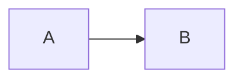

# 安全與失敗範例

> Draft · 合成測試資料。下列攻擊字串用於驗收，不會執行。

## Raw HTML 與 URL


<script>window.__readerXss=1</script>
<iframe src="https://example.invalid/frame"></iframe>

[不安全協定](javascript:alert%281%29)
[資料協定](data:text/html,test)
[跨根路徑](../guide.md)
[編碼跨根](%2e%2e/guide.md)
[雙重編碼](%252e%252e/guide.md)
[協定相對](//example.invalid/test)
[未知文件](unknown.md)
[未知片段](guide.md#不存在的章節)


## 無效 Mermaid

文字替代：此圖故意使用無效語法，沒有可推論的節點關係，請閱讀原碼。

```mermaid
this is deliberately invalid diagram syntax
```

## 圖表設定注入

文字替代：這段圖碼試圖改寫安全設定，應被拒絕；不代表有效圖表。



## 回到文章

[返回閱讀指南](guide.md#開始閱讀)。
